<p align="center">
  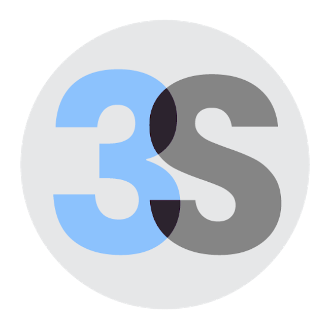
</p>

<h1 align="center">scenelift</h1>

<p align="center"><strong>Film it. Edit it in 3D.</strong></p>

<p align="center">
  A short phone video, or a few photos, becomes a 3D scene in real metres where every object is separate.<br>
  Delete, move and measure things, ask whether something fits, and get an error bar with every answer.
</p>

<p align="center">
  <a href="https://github.com/001shahab/scenelift/actions/workflows/ci.yml"></a>
  <a href="LICENSE"></a>
  
  
  
</p>

<p align="center">
  <a href="#quick-start">Quick start</a> ·
  <a href="#scenelift-studio">Studio</a> ·
  <a href="#use-it-from-python">Python</a> ·
  <a href="#use-it-from-the-command-line">Command line</a> ·
  <a href="#how-it-works">How it works</a> ·
  <a href="docs/DESIGN.md">Design document</a> ·
  <a href="docs/API.md">REST API</a>
</p>

<p align="center">
  <a href="#scenelift-studio">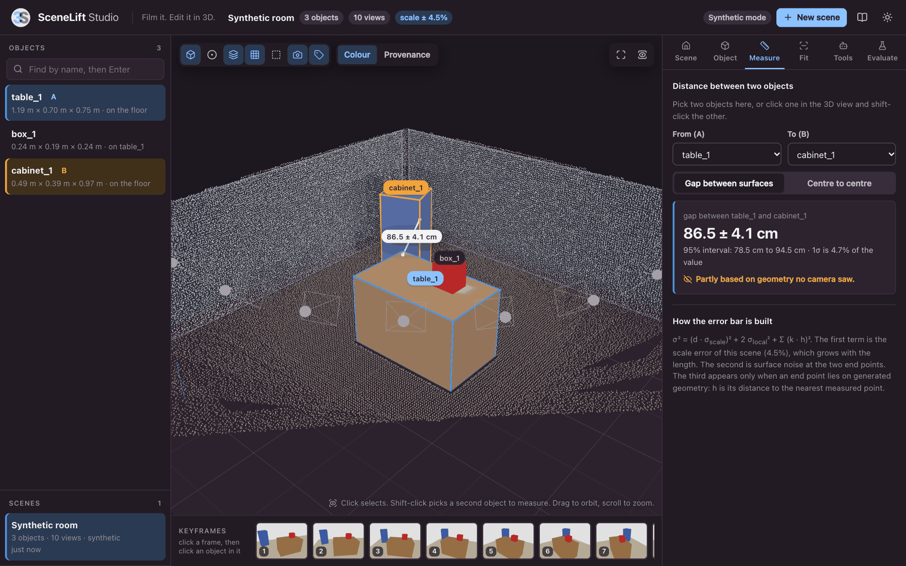</a>
</p>

<p align="center">
  <sub>SceneLift Studio on the built-in synthetic room. The gap between the table and the cabinet is measured on the
  reconstruction, not guessed: 86.5 ± 4.1 cm against a true 84.7 cm. The warning says that one end of it rests on geometry no camera saw.</sub>
</p>

---

## Quick start

```bash
git clone https://github.com/001shahab/scenelift.git
cd scenelift
pip install -r requirements.txt
python app.py
```

A browser tab opens at <http://localhost:8000>. Click **Try the synthetic room**.
The whole geometry core runs on your CPU and a few seconds later you are
looking at a room you can orbit, edit and measure. No GPU, no model weights,
no Node.js, no second process.

```python
from scenelift import SceneLift, query

scene = SceneLift.default().run("room.mp4")

print(query.distance(scene, "sofa_1", "table_1"))
# gap between sofa_1 and table_1: 0.452 m +/- 0.021 (95%: 0.411 to 0.493)

print(query.fits_in_space(scene, "sofa_1", (2.2, 1.0, 0.9)))
# fits: yes (p = 0.98; length spare 14.2 cm +/- 6.1, ...)

scene.remove("table_1")        # whatever stood on the table drops to the floor
scene.export("room.glb")       # one named node per object: Blender, Unity, the web
```

The numbers in the comments show the output format. They are not measurements.

## Where the project stands

scenelift is version 0.1 and it is honest about what that means.

| | State |
|---|---|
| **Geometry core**: every step from keyframes to physics, editing, queries with error bars, selection, save, load, export, command line, evaluation | Implemented. Tested end to end on a synthetic room with exact ground truth, where each view gets its own scale error (about 5 percent) and depth noise |
| **SceneLift Studio**: REST API and browser front end | Implemented, with API tests on the synthetic room. Every panel was exercised by hand in Chrome; the screenshots below come from that run |
| **Real footage, end to end**: MapAnything for geometry, SAM 3 for masks, then the core | **Runs**, on an Apple-silicon laptop with no CUDA: a 13 second phone video becomes a scene with separate objects in about two and a half minutes, from the command line and from Studio. One clip so far, and nothing in it was measured with a tape, so this shows that it works, not how accurate it is. What came out, what had to be fixed and what is still wrong: [docs/BACKENDS.md](docs/BACKENDS.md#the-first-real-scene) |
| **Completion backend**: the SAM 3D Objects wrapper | Written from the project's README and demo code. **Not yet run on real weights**: it needs CUDA. Without it every object is the convex hull of its measured points, flagged as such |
| Trained components of our own, the real-photo benchmark, texture baking, background inpainting, Gaussian splat export | Not built yet. See the [roadmap](#roadmap) |

The synthetic test proves that the geometry and the bookkeeping are right. It
does not prove quality on real rooms. One real room has been reconstructed,
with no ground truth. Measured accuracy on real scenes is the next milestone, and
[results on your own footage](https://github.com/001shahab/scenelift/issues/new?template=real_scene_result.yml)
are the most useful contribution you can make.

## Contents

- [Why scenelift](#why-scenelift)
- [What is different](#what-is-different)
- [Install](#install)
- [SceneLift Studio](#scenelift-studio)
- [Use it from Python](#use-it-from-python)
- [Use it from the command line](#use-it-from-the-command-line)
- [Use it over HTTP](#use-it-over-http)
- [Give it to a language model](#give-it-to-a-language-model)
- [How it works](#how-it-works)
- [The uncertainty model](#the-uncertainty-model)
- [The scene folder](#the-scene-folder)
- [Model backends and their licences](#model-backends-and-their-licences)
- [Evaluate](#evaluate)
- [What the tests show](#what-the-tests-show)
- [Configuration](#configuration)
- [Repository layout](#repository-layout)
- [Development](#development)
- [Roadmap](#roadmap)
- [Known limitations](#known-limitations)
- [Questions](#questions)
- [Contributing](#contributing)
- [Citation](#citation)
- [Licence and credits](#licence-and-credits)

## Why scenelift

Computer vision is strong at 2D recognition and segmentation. It is still weak
at turning ordinary photos into a 3D understanding that a person or a program
can use.

The target: given a short casual phone video, or a few photos, of a real
scene, produce a clean, metric, editable 3D representation of the scene and
its objects, plus reliable spatial answers. No careful capture, no special
hardware, no manual clean-up. That means all of the following at once:

1. **Metric scale.** Sizes and distances in real metres.
2. **Object-level output.** Each object is separate and has complete geometry.
3. **Consistency across views.** No floaters, no warped or doubled objects.
4. **Physical plausibility.** Objects rest on something. They do not float or sink.
5. **Promptable.** A click, a box or a word selects an object.
6. **Spatial answers.** "How far is the chair from the table?", "Will this fit there?"
7. **Consumer hardware**, or a clear cloud option.
8. **Real scenes**: cluttered, badly lit, partly occluded.

Each requirement has a strong public model. None covers the combination.

| Family | Gives | Missing |
|---|---|---|
| Feed-forward metric geometry (MapAnything, Depth Anything 3, the VGGT line) | Depth, cameras and points in metres from 1 to N images | No objects. Scale drifts between views. No error bars |
| Single-image object reconstruction (SAM 3D Objects, CAST, 3D-RE-GEN) | Complete textured objects with a layout guess | One image only. Scale and placement are guesses. Seen and unseen parts are not told apart |
| Physics-aware composition (SimuScene and related) | Scenes that survive a simulator | Single image, research code, no measurement |
| Spatial question answering (vision-language models) | Fluent answers | The numbers are guessed, not computed |

scenelift targets the gaps between them:

- **Gap A**: few-view casual capture (2 to 30 frames) with object-level output.
- **Gap B**: a strict separation between what was measured and what was generated.
- **Gap C**: calibrated uncertainty on every length and every "fits" answer.
- **Gap D**: spatial answers computed on the reconstruction, exposed as tools for language models.
- **Gap E**: one package that installs with one command and exports to standard formats.

## What is different

**Measure first, generate second.** Pose and scale always come from multi-view
measurement. A generative model is only allowed to fill in what no camera saw,
and its shape is accepted only if it agrees with the measurements: it must not
sit where a camera saw through, and its outline must match the masks.

**Never hide a guess.** Every vertex is tagged *observed* or *generated*.
Every answer carries a sigma, a 95 percent interval, and a flag when it leans
on generated geometry. In Studio, switch the 3D view to **Provenance** and the
back of the cabinet that no camera saw turns amber.

**A fit answer is a probability.** "Will it fit?" returns yes, no or
*uncertain*, with the probability and the spare room per axis. When the
margin is smaller than the error bar, it says so instead of guessing.

**Numbers are computed, not written by a language model.** The same queries
are JSON tool definitions. A model turns the question into a call. The number
comes from the reconstruction.

**Frozen backbones behind small interfaces.** scenelift trains no foundation
model. Depth, masks and shape generation are plug-ins behind three small
interfaces, so a better model can be swapped in without touching the core.

**Simple geometry that can be explained.** Upright boxes, planes, voxel
overlap, ICP. Each step can be tested alone, and the core runs on a laptop
with no GPU.

## Install

Python 3.10 or newer. There is exactly one requirements file.

```bash
git clone https://github.com/001shahab/scenelift.git
cd scenelift

python -m venv .venv
source .venv/bin/activate            # Windows: .venv\Scripts\activate

pip install -r requirements.txt
```

That installs the geometry core (NumPy, SciPy, OpenCV, trimesh, Pillow),
SceneLift Studio (FastAPI, uvicorn) and the test tools (pytest, httpx). It is
enough for everything on a laptop: Studio with the synthetic room, the tests,
the examples, and working with scenes that were already reconstructed.

| Command | Does |
|---|---|
| `python app.py` | Starts SceneLift Studio at <http://localhost:8000> |
| `pytest -q` | Runs the test suite on the synthetic room, on the CPU (about a minute) |
| `python examples/quickstart.py` | Reconstructs, measures, edits and exports from a script |
| `pip install -e .` | Optional. Puts the `scenelift` command on your PATH. Without it, use `python -m scenelift.cli` |

Reconstructing **real footage** also needs the model backends (PyTorch,
MapAnything, SAM 3 and, optionally, SAM 3D Objects). They are separate
projects, installed from their own repositories:
[docs/BACKENDS.md](docs/BACKENDS.md).

## SceneLift Studio

```bash
python app.py                          # http://localhost:8000
python app.py --port 9000              # another port
python app.py --scenes-dir ~/scenes    # another scene library (default: ./scenes)
python app.py --no-browser             # do not open a browser tab
python app.py --sam3d-repo /path/to/sam-3d-objects   # enable generative completion
python app.py --help                   # every option
```

The front end is React, TypeScript and three.js. It is already compiled into
the Python package, so `python app.py` is the only thing to run.

<p align="center">
  <picture>
    <source media="(prefers-color-scheme: dark)" srcset="docs/images/studio-overview-dark.png">
    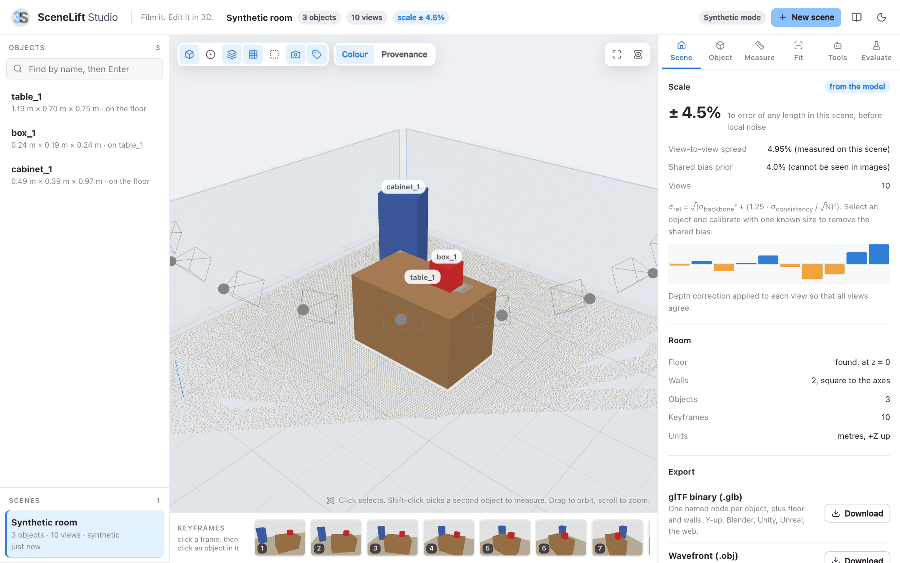
  </picture>
</p>

Every screenshot in this section was taken from a running Studio on the
synthetic room, at the default settings.

**Make a scene**

- *Synthetic room.* A table, a box standing on it and a cabinet turned by 20
  degrees, between two walls. Depth is ray-cast exactly, then each view gets
  its own scale error and pixel noise, which is how real depth models fail.
  Choose the number of views, the noise, and what the shape generator does:
  the right shape in a wrong pose, a wrong shape (a sphere, which must be
  rejected), or no generator at all. The true sizes are stored with the scene.
- *Your footage.* Drop a short video or a few photos. Each pipeline stage
  reports its progress. This needs the model backends.

<table>
  <tr>
    <td width="50%">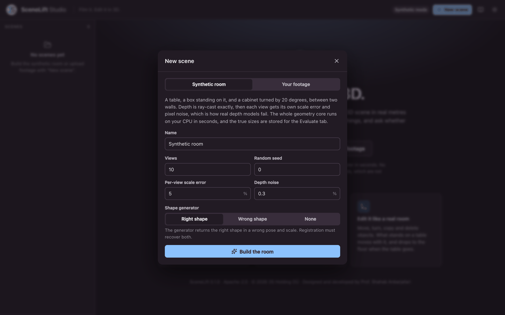</td>
    <td width="50%">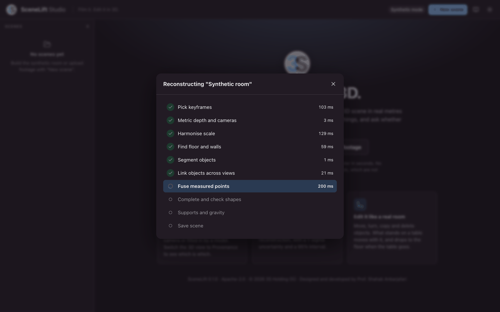</td>
  </tr>
  <tr>
    <td align="center"><sub>Choose the views, the noise and what the shape generator does</sub></td>
    <td align="center"><sub>Every stage of the pipeline reports in, with its time</sub></td>
  </tr>
</table>

**Look at it**

- A 3D view with orbit, zoom and a top-down view. Toggle surfaces, measured
  points, background points, the room, upright boxes, cameras and labels.
- **Colour** shows what the camera saw. **Provenance** shows observed geometry
  in blue and generated geometry in amber.
- The keyframes sit under the 3D view. Open one, click an object in the photo
  to select it, or drag a box around several.

<table>
  <tr>
    <td width="50%">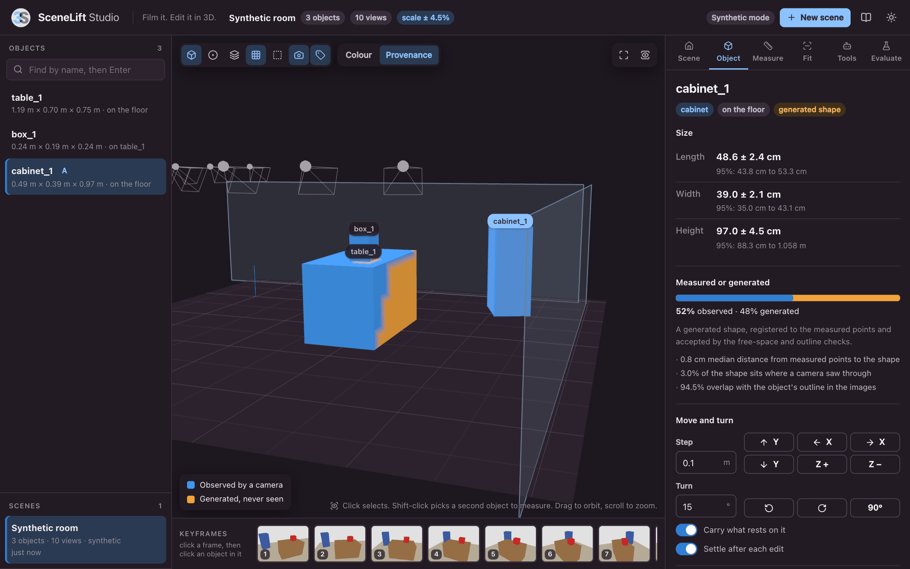</td>
    <td width="50%">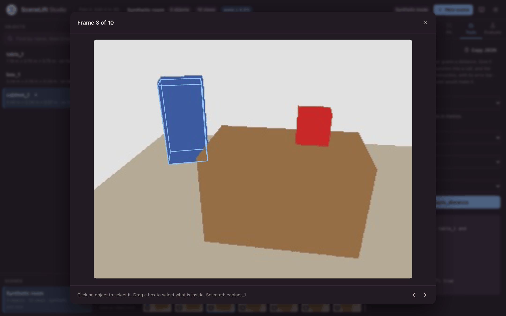</td>
  </tr>
  <tr>
    <td align="center"><sub>Provenance, seen from where no camera stood: blue was measured, amber was generated</sub></td>
    <td align="center"><sub>Click an object in a keyframe to select it. Its upright box is drawn into the photo</sub></td>
  </tr>
</table>

**Edit it**

- Move in steps along X, Y and Z, turn about the vertical axis, duplicate,
  drop onto whatever is underneath, remove.
- What stands on a table moves with the table, and falls to the floor when the
  table is removed.
- Enter one size you know. The whole scene is rescaled and the shared scale
  error is replaced by the error of your tape measure.

<p align="center">
  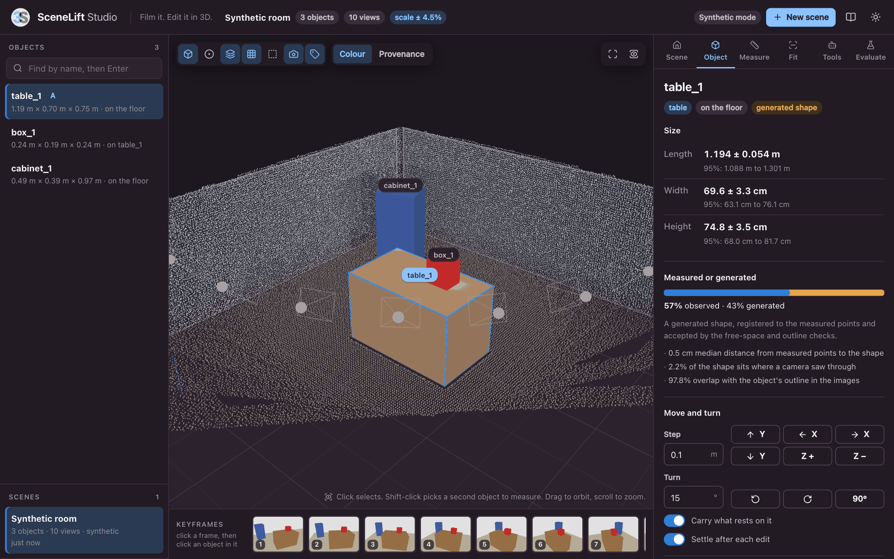
</p>

**Ask it**

- *Object*: length, width and height with sigma and 95 percent interval, the
  share of the surface that was observed, and the fit diagnostics of the
  generated shape.
- *Measure*: the gap between two objects, surface to surface or centre to
  centre, drawn in the 3D view. Shift-click picks the second object.
- *Fit*: will it fit in a space of given size, will it fit between two other
  objects, and where on the free floor could it stand. A proposed spot can be
  applied with one click.
- *Tools*: call the language-model tools by hand, exactly as a model would.
- *Evaluate*: paste tape-measure ground truth and get accuracy and calibration.
  For the synthetic room the exact truth is filled in.
- *Scene*: the scale uncertainty and where it comes from, the correction
  applied to each view, the room, timings per stage, the edit history, every
  tunable number used, and downloads as glTF, OBJ, PLY, a point cloud or the
  scene folder.

<table>
  <tr>
    <td width="50%">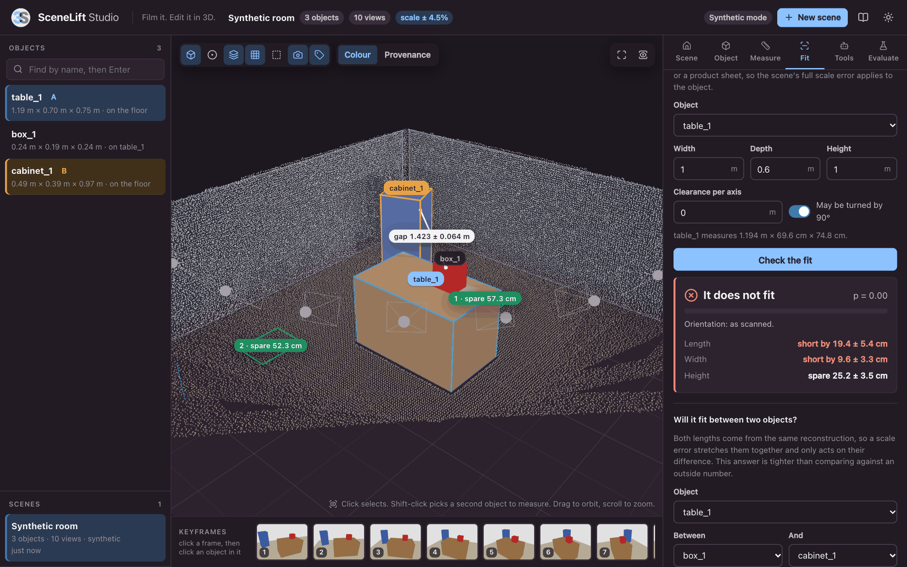</td>
    <td width="50%">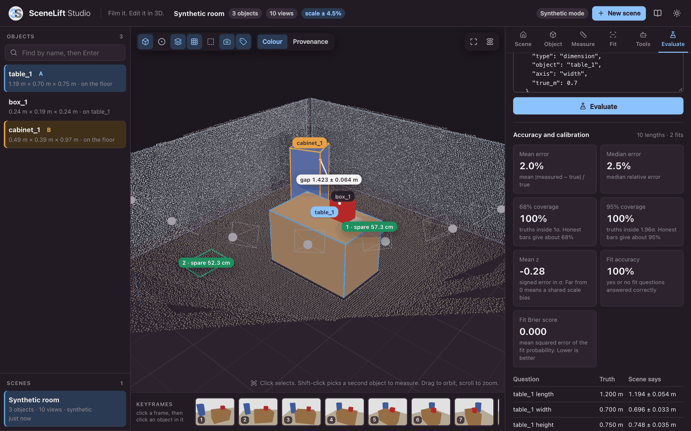</td>
  </tr>
  <tr>
    <td align="center"><sub>Fit: a probability and the margin per axis, and free floor spots drawn into the 3D view</sub></td>
    <td align="center"><sub>Evaluate: accuracy and calibration against ground truth</sub></td>
  </tr>
  <tr>
    <td width="50%">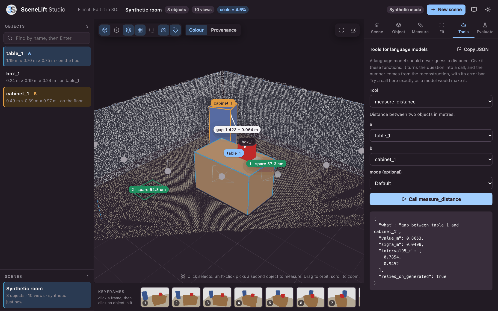</td>
    <td width="50%">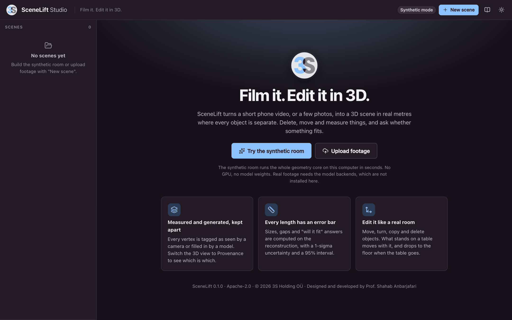</td>
  </tr>
  <tr>
    <td align="center"><sub>Tools: the calls a language model would make, and the JSON it gets back</sub></td>
    <td align="center"><sub>The first page: one click builds the synthetic room</sub></td>
  </tr>
</table>

Light and dark themes. Studio is a local tool for one user and has no
authentication: read [SECURITY.md](SECURITY.md) before exposing it to a network.

### A real room

Every screenshot above shows the synthetic room. These three show the first
real one: a 13 second phone video of a living room, reconstructed on a laptop
with MapAnything and SAM 3 in about two and a half minutes. 107 objects came
out of it.

<p align="center">
  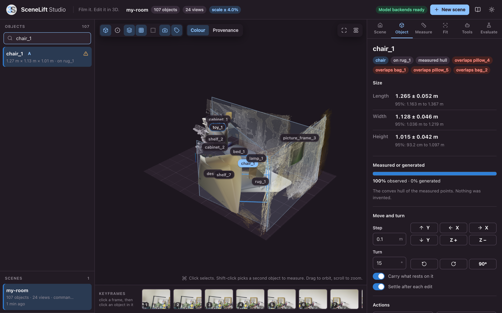
</p>

<table>
  <tr>
    <td width="50%">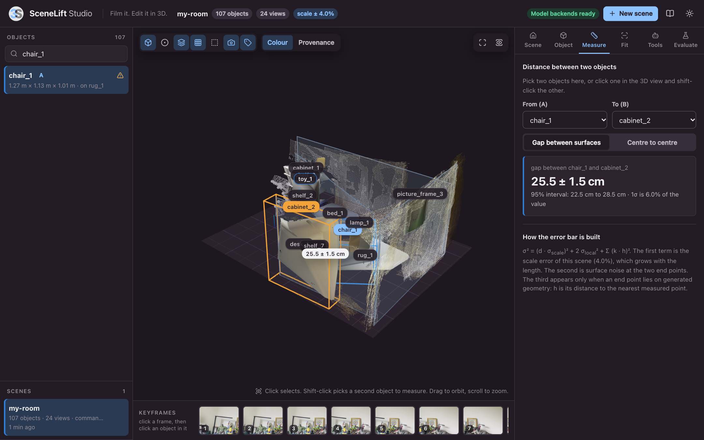</td>
    <td width="50%">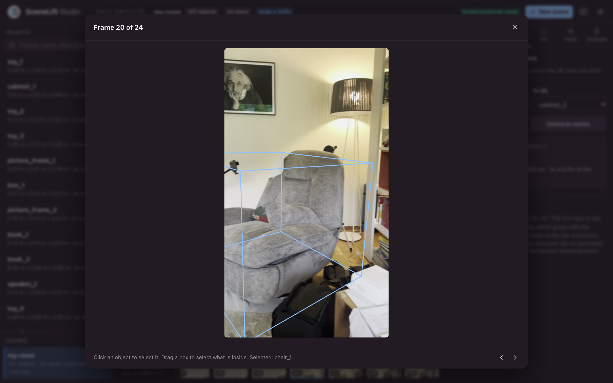</td>
  </tr>
  <tr>
    <td align="center"><sub>The gap between the armchair and the bookcase, with its error bar</sub></td>
    <td align="center"><sub>The armchair's box, drawn back into the keyframe it was selected in</sub></td>
  </tr>
</table>

Read these as "it runs", not as "it is accurate". Nothing in that room was
measured with a tape, so the 25.5 cm is unchecked. The armchair is a convex
hull, because no shape generator was run, and the red flags on it are real:
the hulls of the pillows and bags on and around the chair overlap its hull. What went wrong on the way
there, and what is still wrong, is written down in
[docs/BACKENDS.md](docs/BACKENDS.md#the-first-real-scene).

## Use it from Python

```python
from scenelift import SceneLift, Scene, query, select

# reconstruct (needs the model backends)
scene = SceneLift.default().run("room.mp4")           # a video, a folder, one photo or a list of paths
scene = SceneLift.default(sam3d_repo="/path/to/sam-3d-objects").run("photos/")

# look
scene.summary()                                       # id, size, position, support, flags per object
scene.scale.sigma_rel                                 # relative 1-sigma error of any length

# ask: every answer is a Measurement or a FitResult
query.dimensions(scene, "sofa_1")                     # length, width, height
query.distance(scene, "sofa_1", "table_1")            # surface to surface
query.distance(scene, "sofa_1", "table_1", "center")
query.distance_to_wall(scene, "sofa_1")
query.fits_in_space(scene, "sofa_1", (2.2, 1.0, 0.9)) # width, depth, height of the space
query.fits_between(scene, "chair_1", "table_1", "cabinet_1")
query.find_placements(scene, "chair_1")               # free, observed floor

m = query.distance(scene, "sofa_1", "table_1")
m.value, m.sigma, m.interval95, m.relies_on_generated

# select
select.by_click(scene, camera_index=3, u=412, v=260)  # object under a pixel of keyframe 3
select.by_box(scene, 3, (100, 80, 400, 300))
select.by_text(scene, "chair")

# edit
scene.translate("sofa_1", (0.5, 0, 0))                # whatever rests on it moves too
scene.rotate("sofa_1", 90)
new_id = scene.duplicate("chair_1", offset=(0.6, 0, 0))
scene.remove("table_1")                               # its load drops to the surface below
scene.calibrate(measured=2.11, true=2.03)             # one known length fixes the scale
scene.settle()                                        # re-run supports and gravity

# keep
scene.save("room")
scene = Scene.load("room")
scene.export("room.glb")                              # also .obj and .ply
scene.export_points("room_points.ply")
```

No GPU at hand? The synthetic room runs the same pipeline on the CPU:

```python
from scenelift import Config, SceneLift
from scenelift.backends.synthetic import (SyntheticCompleter, SyntheticGeometry,
                                          SyntheticSegmenter, SyntheticWorld)

world = SyntheticWorld(seed=0)
lift = SceneLift(SyntheticGeometry(world), SyntheticSegmenter(world), SyntheticCompleter(world), Config())
scene = lift.run_frames(world.frames())
```

More in [examples/](examples/).

## Use it from the command line

After `pip install -e .` the command is `scenelift`. Without it, write
`python -m scenelift.cli` instead.

```bash
# reconstruct (needs the model backends)
scenelift run room.mp4 -o room --export room.glb
scenelift run room.mp4 -o room --sam3d-repo /path/to/sam-3d-objects
scenelift run photos/ -o room --max-frames 16 --prompts "sofa, table, chair, lamp"
scenelift run room.mp4 -o room --reference door_1 height 2.03     # calibrate while reconstructing

# look and ask
scenelift info room
scenelift size room sofa_1
scenelift measure room sofa_1 table_1
scenelift measure room sofa_1 table_1 --mode center
scenelift fit room sofa_1 --space 2.2 1.0 0.9
scenelift fit room chair_1 --between table_1 cabinet_1
scenelift place room chair_1

# edit: the scene folder is updated
scenelift edit room remove table_1
scenelift edit room move sofa_1 0.5 0 0
scenelift edit room rotate sofa_1 90
scenelift edit room duplicate chair_1
scenelift calibrate room door_1 height 2.03

# keep and check
scenelift export room room.glb
scenelift eval room ground_truth.json
scenelift studio                                                  # the same as python app.py
```

## Use it over HTTP

Studio is a REST API with a front end on top. Everything the browser does,
`curl` can do. Interactive documentation is at `/api/docs` while the server
runs, and every route is described in [docs/API.md](docs/API.md).

```bash
# build the synthetic room, then poll the job until it is done
curl -X POST localhost:8000/api/scenes/demo -H 'Content-Type: application/json' -d '{"name": "Room"}'
curl localhost:8000/api/jobs/<job id>

# ask and edit
curl -X POST localhost:8000/api/scenes/room/query/distance \
     -H 'Content-Type: application/json' -d '{"a": "table_1", "b": "cabinet_1"}'
curl -X POST localhost:8000/api/scenes/room/edit \
     -H 'Content-Type: application/json' -d '{"op": "remove", "object": "table_1"}'

# download
curl -OJ "localhost:8000/api/scenes/room/export?format=glb"
```

## Give it to a language model

A language model should never guess a distance. `query.TOOLS` holds JSON tool
definitions for function calling, and `query.call_tool` runs a call on the
scene. The model translates the question. The number comes from the
reconstruction, with its error bar.

```python
from scenelift import Scene, query

scene = Scene.load("room")
tools = query.TOOLS    # list_objects, get_dimensions, measure_distance,
                       # check_fit_in_space, check_fit_between, find_placements

# pass `tools` to your provider's chat API; for each tool call the model makes:
result = query.call_tool(scene, "measure_distance", {"a": "sofa", "b": "table"})
```

Objects can be named by id (`sofa_1`) or by word (`sofa`). An ambiguous word
is an error that lists the candidates, so the model can ask again.
[examples/llm_tools.py](examples/llm_tools.py) shows the loop, and the
**Tools** tab of Studio lets you make the calls by hand.

## How it works

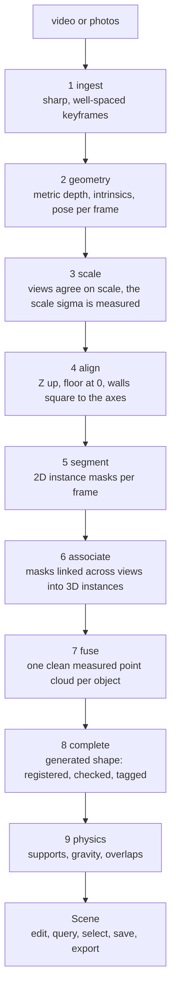

Steps 2, 5 and 8 call a model backend. Everything else is scenelift's own
code and runs on the CPU. The [design document](docs/DESIGN.md) gives every
micro step, parameter and failure mode. In short:

| Step | File | What it does |
|---|---|---|
| 1. Ingest | `ingest.py` | Reads a video, a folder or photos, applies EXIF orientation, and keeps 8 to 24 frames. Sharpness is the variance of the Laplacian. The timeline is split into windows and the sharpest frame of each is kept, then frames are dropped where the median optical flow says the camera stood still |
| 2. Geometry | `backends/mapanything.py` | One feed-forward pass gives z-depth in metres, intrinsics, camera pose, confidence and validity per frame. Confidence is squashed per view so one threshold works across scenes |
| 3. Scale | `scale.py` | **First contribution.** Each view's points are projected into the other views and the median log depth ratio gives that view's scale error. The corrections are centred so they never shift the global scale, applied, and the process is repeated once. The spread of the corrections becomes `sigma_consistency`: the scene measures how unstable its own scale was |
| 4. Align | `align.py` | RANSAC finds the floor, using the camera "up" direction as a prior and a penalty for points below the plane, which separates the floor from table tops and the ceiling. The world is rotated to Z-up with the floor at 0. Walls are found the same way, the largest snaps to an axis, and every wall normal points into the room |
| 5. Segment | `backends/sam3.py` | Each view is queried with every word of the prompt list (37 household nouns by default, replaceable) |
| 6. Associate | `association.py` | Masks are eroded by one pixel, unprojected and voxelised at 5 cm. Masks join an instance when their voxels overlap enough. The required overlap rises when labels differ or when one piece is much smaller, which keeps a mug apart from the table it stands on. A second pass merges instances that were never seen together, using a projection test for wide baselines |
| 7. Fuse | `fusion.py` | Voxel-average at 1 cm weighted by confidence, remove statistical outliers with a floor on the spread so edges survive, keep the largest cluster only if it holds 60 percent of the points. What is left over becomes the background |
| 8. Complete | `completion.py`, `backends/sam3d.py` | **Second contribution.** A generated mesh arrives in an unknown frame and scale, both of which are ignored. It is registered to the measured points from 48 starting poses with a one-way, trimmed, similarity ICP: the unseen back of the model is never asked to match anything. A free-space test rejects geometry where a camera saw through. The size is refined against the mask outlines. The shape is accepted only if it passes all checks; otherwise the convex hull of the measured points is used and the object is flagged. Each vertex is then tagged observed or generated |
| 9. Physics | `physics.py` | Every object gets an upright box. Working from the lowest object upward, each one finds what it stands on, small gaps are closed, small overlaps are pushed apart, and what cannot be explained is flagged `floating` or `overlaps:<id>` rather than silently fixed |
| 10. Scene | `scene.py` | Objects, layout, background, cameras, scale information, config and edit history. Edit, save, load, export |
| 11. Query | `query.py` | Dimensions, distances, fit checks and placements, each with its uncertainty. The same queries as tools for language models |
| 12. Select | `select.py` | By click and by box in any keyframe, using a z-buffered render of the objects, and by text |

Conventions, used everywhere:

- Units are metres.
- The camera frame is OpenCV: `+X` right, `+Y` down, `+Z` forward. `cam2world` is 4x4.
- After step 4 the world is Z-up with the floor at `z = 0`.
- A pixel `(u, v)` is `(column, row)`. Integer coordinates are pixel centres.
- Every tunable number lives in [`scenelift/config.py`](scenelift/config.py).

## The uncertainty model

Every length `d` comes with a sigma:

```
sigma^2 = (d * sigma_rel)^2  +  2 * sigma_local^2  +  sum over generated end points of (k * h)^2
```

| Term | Meaning | Default |
|---|---|---|
| `sigma_rel` | Relative scale error of the scene. It grows with the length | Measured per scene, see below |
| `sigma_local` | Surface noise at each of the two end points | 8 mm |
| `k * h` | Only for an end point on generated geometry. `h` is its distance to the nearest measured point of the same object | `k` = 0.15 |

The scale error has two parts:

```
sigma_rel = sqrt( sigma_backbone^2 + (1.25 * sigma_consistency / sqrt(N))^2 )
```

- `sigma_consistency` is the view-to-view spread measured in step 3. Its
  share is the standard error of the median over `N` views.
- `sigma_backbone` (4 percent by default) is a prior on the scale bias shared
  by all views. That bias **cannot be seen in the images**. One known length
  removes it: `scene.calibrate(measured, true)`, or the Calibrate panel in
  Studio, switches `sigma_rel` to the error of your reference.

A fit answer is a probability: the product over the axes of
`Phi(margin / sigma)`. It reads **yes** at 0.95 or above, **no** at 0.05 or
below, and **uncertain** in between.

Two fit questions, two different error bars:

- `fits_in_space` compares against an outside number (a tape measure, a
  product sheet), so the full scale error applies.
- `fits_between` compares two lengths from the same reconstruction. A scale
  error stretches both together and only acts on their difference. The answer
  is tighter, and that is correct.

`find_placements` treats floor that no camera saw as **unknown, not free**.

The constants are stated openly and are meant to be fitted on a benchmark of
real scenes. Today they were set on synthetic data.

## The scene folder

```
my_scene/
  scene.json          units, up axis, objects, layout, scale, cameras, config, edit history
  objects/<id>.npz    points, colors, mesh_vertices, mesh_faces, mesh_colors, vertex_observed
  background.npz      points, colors
  depth.npz           per-view depth as float16 (optional)
  frames/0000.jpg     the keyframe of each camera (optional)
```

Plain JSON, NumPy arrays and JPEG images, so a web viewer or a game-engine
plug-in can read it without scenelift. Every key is described in
[docs/SCENE_FORMAT.md](docs/SCENE_FORMAT.md).

| Export | Result |
|---|---|
| `scene.export("room.glb")` | One named node per object plus floor and wall quads, converted to Y-up as glTF requires |
| `scene.export("room.obj")`, `scene.export("room.ply")` | Meshes, Z-up, metres |
| `scene.export_points("points.ply")` | Every measured point as one coloured PLY |

## Model backends and their licences

scenelift's own code is Apache 2.0. The backends are separate installs and are
never bundled.

| Role | Default | Code and weights licence | Hardware |
|---|---|---|---|
| Geometry | MapAnything, checkpoint `facebook/map-anything-apache` | Apache 2.0 code, Apache 2.0 checkpoint | CUDA recommended. Runs on Apple MPS: 24 frames in 20 s on an M5 Max. CPU not tried |
| Segmentation | SAM 3, through Hugging Face `transformers` | SAM License (custom, not an OSI licence). The checkpoint is gated on Hugging Face | CUDA recommended. Runs on Apple MPS: 3.7 s per frame for 37 prompts. CUDA and CPU not tried |
| Completion (optional) | SAM 3D Objects | SAM License (custom, not an OSI licence) | CUDA, required by its code |

Please read before you build on them:

1. The SAM License is a custom licence with use restrictions and trade-control
   clauses. Read it in full, ideally with legal advice, before depending on it
   for anything commercial.
2. The other MapAnything checkpoint, `facebook/map-anything`, is not the
   Apache one. Read its model card before use.
3. A default stack of permissively licensed parts only is planned: an Apache
   or MIT segmenter and an MIT image-to-3D model (candidates to verify:
   TRELLIS, TripoSR) behind the same interfaces, with the SAM backends as an
   opt-in.
4. Laptop mode: geometry and segmentation on MPS, no generative completion
   (convex hulls, clearly flagged). This mode has been run. Full mode: one
   CUDA GPU or a cloud endpoint. Not run yet.

Install steps, the smoke test and how to write your own backend:
[docs/BACKENDS.md](docs/BACKENDS.md).

## Evaluate

Is the scale right, and are the error bars honest? Measure a few things with a
tape, write them down, and ask.

```json
[
  { "type": "dimension", "object": "table_1", "axis": "length", "true_m": 1.60 },
  { "type": "distance", "a": "sofa_1", "b": "table_1", "mode": "surface", "true_m": 0.45 },
  { "type": "fit", "object": "chair_1", "space": [0.6, 0.6, 1.0], "true": true }
]
```

```bash
scenelift eval room ground_truth.json
```

| Metric | Meaning |
|---|---|
| `abs_rel_error`, `median_rel_error` | Mean and median of `abs(measured - true) / true` |
| `coverage_68`, `coverage_95` | Share of truths inside the 1 sigma and 1.96 sigma intervals. Honest error bars give about 0.68 and 0.95. Lower means overconfident, higher means the bars are too wide |
| `mean_z` | Mean signed error in sigmas. Far from 0 means a shared scale bias |
| `fit_accuracy`, `fit_brier` | For yes or no fit questions: the share answered correctly, and the mean squared error of the probability |

The same evaluation is the **Evaluate** tab of Studio.

**scenelift-bench** is the planned benchmark, because no public set pairs
casual phone video with tape-measured distances and fit questions: 100 scenes
(60 rooms, 20 table tops, 20 outdoor), each with a 15 to 30 second video and
photo subsets of 2, 5 and 10, at least 10 tape or laser measurements and 5 fit
questions. Baselines on the same scenes: single-view metric depth with masks,
MapAnything points with masks and no harmonisation, the SAM 3D Objects layout
from one image, Gaussian splatting measured by hand, and a vision-language
model asked the same questions directly.

## What the tests show

```bash
pytest -q                              # everything
pytest -q tests/test_synthetic.py      # the geometry core
pytest -q tests/test_studio.py         # the Studio REST API
```

The synthetic room: a table, a small box on the table, a cabinet turned 20
degrees, two walls and a floor. Ten views at 320 x 240 on a 130 degree arc.
Each view's depth is multiplied by a random factor (5 percent spread) and
given 0.3 percent pixel noise. The completer returns the right shape in a
wrong pose and scale. The segmenter gives perfect masks without track ids.

What the core tests check, as recorded in the
[design document](docs/DESIGN.md#10-what-the-tests-show-today):

| Check | Result |
|---|---|
| Per-view scale errors recovered | Residual spread below 0.6 percent |
| Floor at z = 0, walls square to the axes | Within 1 cm, exact axes |
| Object sizes | Within 1 to 3 percent with 10 views at low noise, within 5 percent with 3 to 10 views at double noise, within 12 percent with 2 wide-baseline views |
| Table to cabinet gap | Within 5 cm of 0.85 m, truth inside the 95 percent interval |
| Supports | Box on table, table and cabinet on floor |
| Edits | The box rides with the table and drops to the floor when the table is removed |
| Wrong shape from the completer | Rejected, hull used, flag set |
| Two views 130 degrees apart | Three objects, no duplicates |
| Click, box and text selection; save, load, glTF export; CLI; tools; eval | Pass |

`tests/test_studio.py` drives the REST API through the same room: building
it, the scene document and geometry payload, every query, every edit,
calibration, selection in a keyframe, the tools, evaluation, all export
formats, and persistence across a restart.

Last recorded run, 13 November 2026, Python 3.13 on macOS (Apple silicon):
62 passed and 3 skipped in 68 s. The three skipped tests are the live backend
tests below. With MapAnything and SAM 3 installed and a real clip given: 65
passed in about 3 minutes.

Five of these tests exist because of the first real scene. Real segmenters
return nested masks (a "cabinet" mask covers the books in it), real floors
come out a few centimetres from flat, and real confidence maps differ in
level from frame to frame. The synthetic room now has a nested-mask variant
in both orders, and the other three are small unit tests.

**What this does not show**: behaviour with real depth errors (smeared edges,
non-rigid drift, reflective and transparent surfaces), real segmentation
errors, and real generated shapes that are only approximately right.

`tests/test_backends_live.py` is the smoke test for the real backends. It is
skipped unless they are installed and `SCENELIFT_TEST_INPUT` points at a video
or a folder of photos:

```bash
SCENELIFT_TEST_INPUT=/path/to/room.mp4 pytest -q tests/test_backends_live.py
```

| Live test | Needs | State |
|---|---|---|
| The geometry backend returns what the pipeline assumes: metric depth, intrinsics, a rigid pose, confidence in 0 to 1 | MapAnything | Passes on a 13 s phone video of a room |
| Real depth through scale harmonisation, gravity, floor and walls, fusion, save and load | MapAnything | Passes on the same video: 24 views agree on scale to within 1 percent, floor and walls found |
| The whole pipeline, with objects, saved and exported | MapAnything and SAM 3 | Passes on the same video |

These passes mean that the code runs on real depth and real masks. With no
tape measurements of that room, they say nothing about accuracy.

## Configuration

Every tunable number of the pipeline is a field of
[`scenelift.Config`](scenelift/config.py), with its unit and meaning next to it.

```python
from scenelift import Config, SceneLift

cfg = Config(max_frames=16, prompts=["sofa", "table", "chair"], backbone_scale_sigma=0.03)
scene = SceneLift.default(cfg).run("room.mp4")
```

| Group | Examples |
|---|---|
| Ingest | `max_frames` (24), `frame_stride` (3), `min_flow_px` (12), `max_image_side` (1280) |
| Geometry filtering | `min_conf` (0.3), `depth_edge_rel` (0.04), `max_depth` (12 m) |
| Scale | `scale_gate` (0.25), `scale_min_matches` (300), `backbone_scale_sigma` (0.04) |
| Layout | `floor_max_tilt_deg` (35), `wall_min_fraction` (0.04), `max_walls` (4) |
| Association | `prompts`, `mask_erode_px` (1), `assoc_voxel` (0.05 m), `assoc_overlap` (0.25), `assoc_cover` (0.3), `assoc_projection` (0.7), `min_views_per_object` (2) |
| Fusion | `fuse_voxel` (0.01 m), `background_voxel` (0.025 m) |
| Completion | `observed_tau` (0.025 m), `max_freespace_violation` (0.25), `min_fit_quality` (0.72) |
| Physics | `support_tol` (0.06 m), `max_push` (0.04 m) |
| Uncertainty | `sigma_local` (0.008 m), `generated_sigma_frac` (0.15), `fit_yes` (0.95), `fit_no` (0.05) |
| Storage | `save_depth`, `save_frames` |

The Studio server is configured with command-line flags or environment
variables:

| Flag | Environment variable | Default |
|---|---|---|
| `--host` | `SCENELIFT_HOST` | `127.0.0.1` |
| `--port` | `SCENELIFT_PORT` | `8000` |
| `--scenes-dir` | `SCENELIFT_SCENES_DIR` | `./scenes` |
| `--device` | `SCENELIFT_DEVICE` | chosen by the backends |
| `--sam3d-repo` | `SAM3D_REPO` | none |
| | `SCENELIFT_MAX_UPLOAD_MB` | `2048` |

## Repository layout

```
app.py                 python app.py: starts SceneLift Studio
requirements.txt       the one requirements file
scenelift/
  __init__.py          public API
  config.py            every tunable number
  types.py             Frame, View, Mask2D, CompletedShape
  geometry.py          cameras, voxels, planes, Umeyama, partial ICP, upright boxes, SAT
  ingest.py            step 1
  scale.py             step 3, ScaleInfo
  align.py             step 4, Layout
  association.py       step 6
  fusion.py            step 7
  completion.py        step 8
  physics.py           step 9
  scene.py             Scene, SceneObject, editing, save, load, export
  query.py             step 11, TOOLS
  select.py            step 12
  pipeline.py          SceneLift: runs steps 1 to 9
  eval.py              accuracy and calibration metrics
  cli.py               command line
  backends/            base.py (the three interfaces), mapanything.py, sam3.py, sam3d.py, synthetic.py
  studio/              the web application: REST API, jobs, scene library, compiled front end
frontend/              React + TypeScript + three.js source of the front end
static/img/logo.png    3S Holding logo
tests/                 test_synthetic.py, test_studio.py, test_backends_live.py
docs/                  DESIGN.md, API.md, SCENE_FORMAT.md, BACKENDS.md, images/ (the screenshots)
examples/              quickstart.py, llm_tools.py, ground_truth.example.json
```

## Development

```bash
pip install -r requirements.txt
pytest -q
```

The front end needs Node.js 20 or newer, and only when you change it:

```bash
cd frontend
npm install
npm run dev          # http://localhost:5173 with hot reload; /api goes to python app.py on port 8000
npm run build        # typecheck, then write the bundle into scenelift/studio/static
```

The compiled bundle is committed, so that `python app.py` works without
Node.js. Commit the rebuilt bundle together with the source change.

The Studio server is a thin wrapper by rule: if a route needs logic, the
logic belongs in the library, with a test there.

## Roadmap

**M0. First real scenes.** Started: one room, on a laptop, without ground
truth ([what was observed](docs/BACKENDS.md#the-first-real-scene)). Still to do: install the three backends on one CUDA machine, run
the live smoke test on phone videos, fix the wrappers, review every
intermediate by eye, and record tape measurements. Decision gate: is the scale
error below 8 percent, and are objects separated in most scenes? If not, the
first research task is whichever step failed most often.

**M1. Quality on real scenes**

- R1. Snap observed regions of the generated mesh onto the measured surface, so measured detail is kept exactly.
- R2. Texture: bake multi-view colour onto observed faces, keep generated texture elsewhere.
- R3. Use the SAM 3 video tracker to set `track_id`, and discover prompts automatically with a tagging model.
- R4. Inpaint floor and wall texture behind removed objects.
- R5. Gaussian splat export per object for photoreal viewing, next to the mesh.
- R6. Mesh-level contact and a short physics-simulation check.
- R7. Detect reference objects of known size (doors, sockets, A4 paper, bank cards) and calibrate automatically.

**M2. Trained components, the research core**

- T1. A scale head on frozen backbone features that predicts the per-view scale correction and its sigma. It replaces the fixed prior of step 3.
- T2. A learned start for registration, replacing the 48-start search.
- T3. A calibration layer: fit `sigma_local`, `k` and the acceptance thresholds on the benchmark so that 95 percent intervals cover 95 percent.

**M3. Benchmark and paper.** Collect scenelift-bench, run the baselines, and
write the paper around three claims: measured versus generated separation,
calibrated spatial answers, few-view object-level reconstruction.

**M4. Packaging.** `pip install scenelift` with a permissive default stack.
Dragging objects with the mouse in Studio. A Blender add-on and USD export. A
hosted demo and a Colab notebook. Model card, licence table, limitations page.

**M5. Launch.** A 30 second clip, side-by-side comparisons against the
baselines, and the paper, the demo and the benchmark live on the same day.

## Known limitations

1. Static scenes only. Moving people and pets are not handled.
2. Transparent, mirror-like and very thin objects get poor depth from every current backbone.
3. Objects missing from the prompt list are not separated. They stay in the background.
4. Upright boxes are a coarse stand-in for shape in the physics and fit tests. L-shaped sofas and open shelves are over-approximated.
5. The absolute scale has a shared error that only a reference length, or the planned scale head, can remove.
6. All acceptance thresholds and uncertainty constants were set on synthetic data.
7. Outdoor scenes with no floor plane and no walls fall back to the gravity prior.
8. Symmetric objects can come out turned by 90 or 180 degrees: harmless for geometry, wrong for texture.
9. Real footage has been run on one clip, on Apple silicon, with no ground truth. Accuracy on real scenes is unmeasured. SAM 3D Objects has not been run at all, and nothing has been run on CUDA.
10. A segmenter returns parts and contents as objects of their own: the boards of a shelf unit, the books in a bookcase. They overlap their container, whose own points include them. In the first real scene 71 of 107 objects carry an overlap flag.
11. Without shape completion, an object whose base was not seen ends above the floor and is reported as resting on a wall, or as floating.
12. Objects thinner than the 5 cm association grid, such as books standing side by side, can be mixed up between views.
13. A pan from one spot gives the depth model little parallax. In the first real scene consecutive views agree to about 1 cm where the clip starts and to 3 to 6 cm where it ends. Walk around the room instead.

## Questions

**Do I need a GPU?** Not for the geometry core, Studio with the synthetic
room, the tests, or working with scenes that are already reconstructed.
Reconstructing real footage needs the model backends. MapAnything and SAM 3
have been run on an Apple-silicon laptop without one: about two and a half
minutes for a 13 second video. SAM 3D Objects requires CUDA.

**Can I use it commercially?** scenelift itself is Apache 2.0, so yes. The
default segmentation and completion backends use the SAM License, which is a
custom licence with restrictions. Read it first, or plug in other models.

**Why does it say "uncertain"?** Because the margin is smaller than the error
bar. Calibrate the scene with one known length, or film more views, and ask
again.

**Why is part of my object amber?** No camera saw that part. A generated
shape filled it in, and scenelift will not let you forget that.

**Why is an object missing?** It was probably not in the prompt list. Pass
your own with `--prompts`, or in the upload form of Studio.

**Can I use another depth or segmentation model?** Yes. A backend is any
object with the right method: [docs/BACKENDS.md](docs/BACKENDS.md).

**Where are my scenes?** In `./scenes` next to `app.py`, one folder each.
Change it with `--scenes-dir`.

## Contributing

Bug reports, results on real footage, new backends and documentation are all
welcome. Start with [CONTRIBUTING.md](CONTRIBUTING.md) and the
[code of conduct](CODE_OF_CONDUCT.md). Security problems go to the address in
[SECURITY.md](SECURITY.md), not into a public issue.

## Citation

```bibtex
@software{anbarjafari_scenelift_2026,
  author  = {Anbarjafari, Shahab},
  title   = {scenelift: casual phone video to a metric, editable, object-level 3D scene},
  year    = {2026},
  version = {0.1.0},
  url     = {https://github.com/001shahab/scenelift},
  note    = {3S Holding O\"U}
}
```

## Licence and credits

Copyright 2026 **3S Holding OÜ**. All rights in scenelift belong to 3S Holding OÜ.
It is released under the [Apache License 2.0](LICENSE); see also [NOTICE](NOTICE).

Designed and developed by **Prof. Shahab Anbarjafari** (<shb@3sholding.com>).

The 3S Holding name and logo identify 3S Holding OÜ and are not covered by the
licence. The model backends are separate projects by their own authors, under
their own licences, and are not part of this repository.
