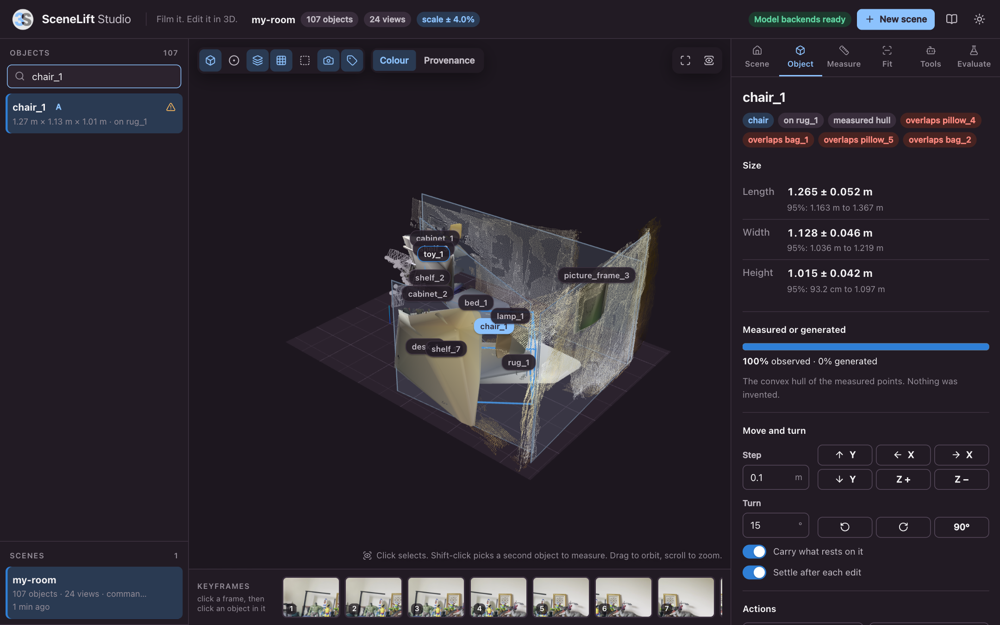

# Model backends

scenelift's own code runs on a laptop CPU and needs no model weights. The
synthetic room in SceneLift Studio and the whole test suite work with
`pip install -r requirements.txt` alone.

Reconstructing **real footage** needs three kinds of model. Each sits behind a
small interface in [`scenelift/backends/base.py`](../scenelift/backends/base.py),
is installed separately from its own repository, and is never bundled with
scenelift.

| Role | Interface | Default | Needed |
|---|---|---|---|
| Geometry: metric depth, intrinsics and pose per frame | `GeometryBackend.infer(frames) -> list[View]` | MapAnything | yes |
| Segmentation: 2D instance masks per frame | `SegmentationBackend.segment(views) -> list[list[Mask2D]]` | SAM 3 | yes |
| Completion: a full mesh from one image and one mask | `CompletionBackend.complete(view, mask) -> CompletedShape or None` | SAM 3D Objects | no |

Without a completion backend every object gets the convex hull of its measured
points, clearly marked as such. Nothing is invented.

## Status: read this first

| Wrapper | State |
|---|---|
| `backends/mapanything.py` | **Run on real weights**, on an Apple-silicon laptop (MPS). One clip so far |
| `backends/sam3.py` | **Run on real weights**, on the same laptop (MPS), through the SAM 3 implementation in Hugging Face `transformers`. One clip so far. CUDA and CPU not tried |
| `backends/sam3d.py` | **Not run yet.** Gated checkpoint, and the code requires CUDA. Expect small fixes on first contact |

So real footage goes all the way through: geometry, masks, separate objects,
queries, edits, export. Every object is the convex hull of its measured
points until SAM 3D Objects (or another completion backend) has been run.
A pull request with fixes, or with a result, is very welcome.

## The first real scene

One run, 13 November 2026, on a MacBook with an M5 Max and 36 GB of memory,
device `mps`, no CUDA. Python 3.13, PyTorch 2.15, MapAnything 1.1.4 (commit
`3d10cf7`), transformers 5.22.2. The input was a 12.8 second hand-held phone
video of a furnished room, 3840 x 2160 HEVC at 60 frames per second, filmed
in portrait as a slow pan from one spot.

```bash
scenelift run room.mov -o room --export room.glb     # 2 min 23 s, weights already cached
```

| Step | Result |
|---|---|
| Keyframes (`ingest.load`) | 24 sharp keyframes, rotated upright, 720 x 1280, in about 10 s |
| Loading the models | MapAnything 15 s and SAM 3 4 s from the cache. The first time: 106 s and 52 s, most of it the 4.9 GB and 3.4 GB downloads |
| Geometry | 19.8 s for 24 frames (two passes, see below), depth maps of 294 x 518 |
| Scale harmonisation | The 24 views agree on scale to within 0.69 percent after correction |
| Layout | Floor found, 4 wall planes, about 75,000 background points |
| Segmentation | 88.7 s: 3.7 s per frame for the 37 default prompts, 578 masks |
| Association, fusion, hulls, physics | 5.1 s on the CPU |
| Scene | 107 objects. The large ones: an armchair of 1.27 x 1.13 x 1.02 m from 7 views, a bookcase of 1.71 x 0.39 x 2.05 m from 5, a shelf unit of 1.31 x 0.55 x 0.94 m from 9, a dog bed from 10, a rug from 9. Then 49 books, 14 figurines, 11 shelf boards, pictures, boxes |
| Studio | The same video, uploaded in the browser, goes through the same pipeline in under three minutes. Selecting in a keyframe and measuring were tried on the result |

What this does **not** show: accuracy. Nothing in that room was measured with
a tape, so every size above is unchecked.

<p align="center">
  
</p>

More screenshots of this scene are in the [README](../README.md#a-real-room).

### What the first contact broke, and what was changed

The first complete run was not usable: large pieces of furniture came out
more than once, or in pieces. Three causes, all fixed:

1. **Confidence was rescaled per frame by its value.** In frames where the
   raw confidence is nearly flat with a few bright spots, a linear rescaling
   pushed almost every pixel of a large plain surface under the threshold:
   99 percent of the armchair was thrown away in four frames. The wrapper
   now maps confidence by rank within the frame and drops the weakest 10
   percent, which is MapAnything's own default.
2. **The focal length drifted.** A phone lens is fixed, yet the estimate
   went from 473 px in textured frames down to 252 px in frames that show
   little but a bare wall, and the geometry broke there. For the frames of
   one video the wrapper now runs the model twice and gives every frame the
   confidence-weighted median of the first estimates. Estimates then stay
   between 413 and 471 px. With this change and the previous one, the
   view-to-view scale spread of the clip went from 0.96 to 0.69 percent.
   Separate photos are left alone, because they may come
   from different cameras. `MapAnythingBackend(share_intrinsics=...)`
   overrides the choice.
3. **Nested masks were taken for the same object.** "cabinet" returns one
   mask for the bookcase with everything in it, so the voxels of a book lie
   inside the voxels of the bookcase. Overlap was measured against the
   smaller of the two, which is 100 percent for any content of any
   container, so a book could take the place of the bookcase in a frame and
   push the bookcase mask into a new object. Association now asks the
   question in both directions, each time restricted to what the photo in
   question can see (`assoc_cover`, design document step 6).

Smaller things from the same run: an object that comes out a few centimetres
below a floor that is not perfectly flat now rests on it instead of on the
nearest wall; Studio shows name tags only for the largest objects of a
crowded scene; and Studio no longer claims that every wall is square to the
axes when one is not.

### What is still wrong in that scene

1. **Parts and contents are objects.** The boards of the shelf unit and the
   books in the bookcase are objects of their own that overlap their
   container, and the container's points still include them. 71 of the 107
   objects carry an overlap flag, and the shelf unit is reported as resting
   on one of its own boards.
2. **Unseen bases.** With no completion backend, an object ends where the
   camera stopped seeing it. Only 3 objects are on the floor; 33 are
   reported as resting on a wall and 8 as floating, most of them wrongly.
3. **One of the four wall planes is not a wall.** It stands 21 degrees off
   the others.
4. **The geometry gets worse along the pan.** Consecutive views agree to
   about 1 cm where the clip starts and to 3 to 6 cm where it ends. A pan
   from one spot gives the depth model little parallax, and its confidence
   falls steadily with the distance from the first frame.
5. **Thin objects.** Books standing side by side are thinner than the 5 cm
   association grid and can be mixed up between views.
6. **Which focal length is right is not known.** The confidence-weighted
   median is a reasonable choice that no ground truth has confirmed.

## Licences

| Backend | Code and weights | Note |
|---|---|---|
| MapAnything, checkpoint `facebook/map-anything-apache` | Apache 2.0 code, Apache 2.0 checkpoint | The default here |
| MapAnything, checkpoint `facebook/map-anything` | Not the Apache checkpoint | Read its model card before use |
| SAM 3 | SAM License | A custom licence, not an OSI open-source licence |
| SAM 3D Objects | SAM License | A custom licence, not an OSI open-source licence |

The SAM License has use restrictions and trade-control clauses. Read it in
full, ideally with legal advice, before depending on it for anything
commercial. scenelift's Apache 2.0 licence covers scenelift only. It gives you
no rights to the backends and their weights.

A default stack made of permissively licensed parts only is on the roadmap:
an Apache or MIT segmenter and an MIT image-to-3D model behind the same
interfaces, with the SAM backends as an opt-in.

## Hardware

| Mode | Geometry | Segmentation | Completion |
|---|---|---|---|
| Full | CUDA GPU | CUDA GPU | CUDA GPU (required by SAM 3D Objects) |
| Laptop | Apple MPS: works, see above. CPU: not tried | Apple MPS: works, see above. CPU: not tried | none: convex hulls, flagged |

## Install

Use the same virtual environment as scenelift. The commands below are the
ones given by each project at the time of writing. If they differ from the
project's current README, the README wins.

### 1. PyTorch

Install the build that matches your GPU from <https://pytorch.org/get-started/locally/>.

### 2. MapAnything (geometry)

```bash
git clone https://github.com/facebookresearch/map-anything
pip install -e map-anything
```

or, without a checkout:

```bash
pip install git+https://github.com/facebookresearch/map-anything.git
```

The checkpoint `facebook/map-anything-apache` (4.9 GB, public, no login) is
downloaded from Hugging Face on first use, into `~/.cache/huggingface`.

MapAnything pins some of its dependencies. In our environment its install
replaced `opencv-python-headless` 5.0 with 4.10. scenelift needs 4.8 or newer
and its test suite passes on both.

### 3. SAM 3 (segmentation)

```bash
pip install transformers
```

scenelift uses the SAM 3 implementation that ships with Hugging Face
`transformers` (5.22.2 was used; any version that has `Sam3Model` will do).
It loads the official weights and is not tied to CUDA: the wrapper picks
CUDA, then Apple MPS, then the CPU. Only MPS has been run. Meta's own [`sam3`](https://github.com/facebookresearch/sam3) package is
not used: it imports `triton`, which exists for Linux with CUDA only, and it
pins NumPy below 2.

The weights, `facebook/sam3` (3.4 GB), are gated on Hugging Face, with manual
approval:

1. Request access on the [model page](https://huggingface.co/facebook/sam3)
   and wait until the request is accepted.
2. Create an access token. A fine-grained token needs the permission to read
   public gated repositories.
3. `hf auth login`, or set `HF_TOKEN` in the environment that starts
   `python app.py` or `scenelift run`.

Without access the first reconstruction stops with a message that says so.
The weights are downloaded once, into `~/.cache/huggingface`.

### 4. SAM 3D Objects (completion, optional)

Follow <https://github.com/facebookresearch/sam-3d-objects>. It needs a CUDA
GPU. Download the checkpoints into `<repo>/checkpoints/hf`, so that
`<repo>/checkpoints/hf/pipeline.yaml` exists. scenelift is then pointed at the
checkout:

```bash
python app.py --sam3d-repo /path/to/sam-3d-objects
scenelift run room.mp4 -o room --sam3d-repo /path/to/sam-3d-objects
```

or with the environment variable `SAM3D_REPO`.

## Check the installation

```bash
python app.py
```

The badge in the top bar reads "Model backends ready" once MapAnything and
the SAM 3 implementation can be imported, and `GET /api/system` lists each
backend. Until both are there, Studio refuses uploads of real footage and
says which one is missing. Whether the gated weights can be downloaded is
only known when the first reconstruction starts.

Then run the smoke test on a short video or a folder of photos:

```bash
SCENELIFT_TEST_INPUT=/path/to/room.mp4 pytest -q tests/test_backends_live.py
SCENELIFT_TEST_INPUT=/path/to/room.mp4 SAM3D_REPO=/path/to/sam-3d-objects \
    pytest -q tests/test_backends_live.py
```

| Test | Needs | Checks |
|---|---|---|
| `test_geometry_backend_contract` | MapAnything | Shapes and types, depth in metres, confidence in 0 to 1, intrinsics, a rigid pose |
| `test_geometry_through_the_core` | MapAnything | Real depth through scale harmonisation, gravity, floor and walls, fusion, save and load, with no masks |
| `test_real_pipeline` | MapAnything and SAM 3 | The whole pipeline, with objects, saved and exported. Skipped without `transformers` or without access to the weights |

All three run on the first 8 keyframes. Together they took 111 s on the
laptop above, with the weights already cached.

## Write your own backend

A backend is any object with the right method. No base class, no registration.

```python
import numpy as np
from scenelift import Config, SceneLift
from scenelift.types import Frame, Mask2D, View


class MyDepthModel:
    def infer(self, frames: list[Frame]) -> list[View]:
        views = []
        for f in frames:
            depth, K, cam2world, conf = my_model(f.image)   # metres, OpenCV camera
            views.append(View(index=f.index, image=f.image, depth=depth.astype(np.float32),
                              K=K, cam2world=cam2world, conf=conf,
                              valid=np.isfinite(depth) & (depth > 0), source=f.source))
        return views


class MySegmenter:
    def segment(self, views: list[View]) -> list[list[Mask2D]]:
        return [[Mask2D(view_index=v.index, mask=m, label=name, score=s)
                 for m, name, s in my_masks(v.image)] for v in views]


scene = SceneLift(MyDepthModel(), MySegmenter(), completer=None, config=Config()).run("room.mp4")
```

What a geometry backend must return per frame:

- `depth`: z-depth in metres, at the resolution of `image`.
- `K`: 3 x 3 intrinsics for that resolution.
- `cam2world`: 4 x 4, OpenCV camera convention.
- `conf`: confidence in the range 0 to 1 (squash it per view, for example
  between the 2nd and 98th percentile, so one threshold works across scenes).
- `valid`: a boolean image, `False` wherever depth is non-finite or not positive.
- `image`: the frame at the same resolution as `depth`.

A segmenter that follows objects through a video should set `Mask2D.track_id`;
association then trusts that identity first. A completion backend may return
its mesh in any frame and at any scale: both are discarded, and the mesh is
registered to the measured points.

`scenelift/backends/synthetic.py` is a complete, small example of all three.
